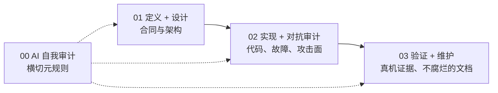

# ai-dev-skills

[English](README.md) · **简体中文**

[](https://github.com/31i45/ai-dev-skills/stargazers)
[](https://github.com/31i45/ai-dev-skills/forks)
[](https://github.com/31i45/ai-dev-skills/commits/main)
[](https://github.com/31i45/ai-dev-skills/pulls)

> 四份清单，把「AI 说做完了」变成**可计数、可验证、可追溯**的产出 —— 为那些*与 AI 协作*、而非自己写代码的人而写。

---

## 为什么有它

把一个任务交给 AI，失败的方式是可预测的：

- **AI 自己批改自己的作业。** 它审阅自己的产出，且永远通过。
- **「做完了」经不起真机考验。** 编译通过、测试通过，用户一碰就坏。
- **文档与代码脱节。** README 里的数字一周内就对不上现实。
- **范围蔓延。** 没人写下「不做什么」，于是什么都做了。

这些都不是打字速度问题 —— 都是流程问题。本仓库是一套小而明确立场的流程：一组在每个阶段运行的 **skill**，其中每份产出都必须是*可计数*的，每个事实声明都必须是*可用一条命令核对*的。

---

## 包含什么

| 文件 | 阶段 | 它逼你回答的问题 |
|---|---|---|
| [00-ai-audit.md](00-ai-audit.md) | 横切 —— **每份**产出后都跑 | *「我是不是在自欺？」* —— 五条强制自检 |
| [01-define-design.md](01-define-design.md) | 写任何代码之前 | *「我们做什么 —— 又不做什么？」* |
| [02-implement-audit.md](02-implement-audit.md) | 构建过程中 | *「它正确吗？别人会怎么攻击它？」* |
| [03-verify-maintain.md](03-verify-maintain.md) | 每次发布之前 | *「它真的能跑吗？文档会不会腐烂？」* |
| [INSTANCE.template.md](INSTANCE.template.md) | 每个项目一份 | 你项目的具体事实：命令、红线、工具名 |

---

## 流水线



- **01 → 02 → 03** 按顺序用于每个功能/发布。Skill 01 内有一道**定义完成门**：每个定义项打勾之前，不得开始设计。
- **00 不是一个阶段。** 它在*任意*产出之后、*任意*阶段运行。

---

## 五条自我审计规则（Skill 00）

整套体系系于此：一个审阅自己产出的 AI，结构性地不可信。Skill 00 强制五条检查，每条都有必须给出、可被查验的产出。

1. **反证义务** —— 先尝试*证伪*方案。写出「我尝试了反例 X，结果 Y」—— 绝不写「没问题」。
2. **简化义务** —— 回答「能不能删掉一半」。写出「我尝试删除 X，结果 Y」—— 绝不未经证明地说「必要」。
3. **风险声明** —— 列出三个具体风险，绝不写「无风险」。每条为 `[触发条件] → [后果] → [严重度] → [缓解措施]` 格式。
4. **可验证性** —— 每个事实声明都附一条命令及其输出中证明该声明的那一行，任何人可复现。
5. **来源标注** —— 每个声明给出来源：`文件:行号`、链接或命令。无来源的声明视为未通过。

审计按*改动类型*分级，而非按量：外观改动（措辞、格式、重命名）只跑规则 4–5；逻辑、架构、安全、依赖改动跑全五条。

---

## 核心原则

- **二八定理** —— 每个阶段先做最重要的 20%，不追求面面俱到。
- **检查清单定位** —— 不强调顺序，强调每条必过。
- **可计数且具体** —— 产出可数（「3 个风险」）且具体到可操作。「可能慢」不是风险。
- **极简主义** —— 能合并的合并，能删的删掉。
- **小项目精简版** —— 每个 skill 标注小项目（功能 ≤3、单人用）的核心子集，让流程永远不会压倒项目本身。
- **通用与实例分离** —— skill 只含普适规则；项目专有事实写入 `INSTANCE.md`。

---

## 项目专有事实放在哪

skill 本体刻意**不含**任何项目事实 —— 无命令、无体积红线、无工具名。所有这类事实集中在一份**实例文件**（`INSTANCE.md`）里，与 skill 并列：

- e2e 命令与场景、数字红线、可观测的不变量
- 核心功能清单与外部输入点清单
- 供应链工具、平台接缝机制、违禁词清单、环境差异事实

**通用规则 + 实例文件**合起来，才是完整可执行的清单。规则保持可跨项目迁移，实例保持具体。项目事实变了，只改一个文件。

---

## 在你的项目中使用

1. 把 `00-ai-audit.md` … `03-verify-maintain.md` 复制进你的项目（放在 `.skills/` 目录下即可）。
2. 把 `INSTANCE.template.md` 复制为 `.skills/INSTANCE.md`，用你项目的真实事实替换所有占位符。
3. 按顺序跑流水线；每个阶段为下一阶段设门。不要跳过 Skill 01 的定义门。
4. *任何*产出之后，跑 Skill 00 的五条规则，并附上它规定的审计块。

---

## 仓库结构

```
ai-dev-skills/
├── 00-ai-audit.md            # 元规则 —— 每份产出后都跑
├── 01-define-design.md       # 问题、约束、架构
├── 02-implement-audit.md     # 测试、故障处理、威胁面
├── 03-verify-maintain.md     # 真机证据、不腐烂的文档、ADR
├── INSTANCE.template.md      # 项目事实模板 —— 复制后填写
├── README.md                 # English
├── README.zh-CN.md           # 你正在读（简体中文）
└── LICENSE                   # MIT
```

---

## 参与贡献

欢迎提 Issue 与 Pull Request。由于这是一套方法论，最有价值的贡献是**反例** —— 某条规则给出错误结果的具体案例，或某个清单项被跳过、随后出事的具体案例。这正是 Skill 00 要求的那类证据。

---

## 许可

基于 [MIT 许可](LICENSE) 发布。
